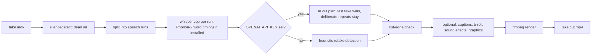
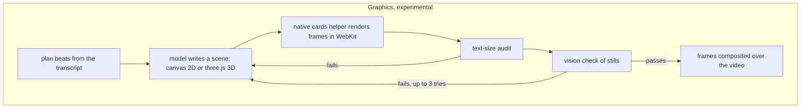

# CutBot editing engine

Give it a talking-head video and it gives back the edit, with the dead air and
the retakes cut out. When you say a line twice it keeps the last take. Optional
extras are captions placed off your face, your own b-roll laid over the video,
sound effects, colour tweaks, volume levelling and (experimental) AI-drawn
animated graphics.

This is the editing engine from CutBot, a hosted video-editing service, pulled
out on its own as a command-line tool and a Python module. The hosted service's
messaging, accounts and billing are not part of it.

```sh
python -m cutbot take.mov -o take.cut.mp4
```

## How it works






1. **Dead air.** ffmpeg's `silencedetect` finds the pauses. Pauses longer than
   the pace threshold (0.45s by default) are cut, with a little padding left
   around the speech.
2. **Speech runs.** The audio is split at finer pauses into "runs", and
   [whisper.cpp](https://github.com/ggml-org/whisper.cpp) transcribes **each
   run on its own**. If you transcribe the whole clip in one go, whisper
   smooths two attempts at a line into one clean sentence and the retake
   disappears from the transcript.
3. **Retakes.** A heuristic (`cutbot/retakes.py`) marks a stretch of runs as an
   abandoned take when the speech right after it opens with nearly the same
   words. That covers false starts and full redos, and a line tried three times
   keeps only the third. Stretches whisper couldn't make out are never cut.
4. **Planning (optional AI).** With `OPENAI_API_KEY` set, an LLM gets the
   numbered runs plus the heuristic's suggestions and decides what to drop. It
   catches asides like "wait, let me redo that", keeps deliberate repetition,
   and follows free-form instructions ("keep the first take of the intro",
   "make it a bit warmer"). Without a key, or with `--no-ai`, the heuristic's
   suggestions are used as they are.
5. **Edge check.** Every cut point is checked against the room's noise floor
   and moved out into the quiet if a word is still audible there, so soft
   endings don't get clipped.
6. **Render.** One ffmpeg pass trims and joins the kept ranges, then lays on
   any b-roll, sound effects, colour grade, graphics and captions, and
   normalises loudness to -14 LUFS.

## Status

Solid. This is what the hosted service ran on every video:

- dead air removal and retake removal (heuristic, and AI-planned)
- the cut-edge check
- loudness levelling and the colour "look" adjustments
- captions (macOS: native `captions` helper, plus `faces` to keep them off the face)
- joining several clips into one video, with retakes found across clips

Works, but less battle-tested:

- `--broll` placement (AI-planned; your own clips and photos only)
- `--sfx` sound effects (AI-planned). The sound files aren't included, see
  [cutbot/assets/sfx/README.md](cutbot/assets/sfx/README.md)
- `--fillers`, which only cuts "um"/"uh" said on their own between pauses,
  because whisper hides fillers that are inside a run
- Phonon-2 transcription (optional, below)

**Experimental:**

- `--graphics`. The AI picks the moments worth showing, writes a small
  canvas animation for each one against `cutbot/assets/graphics/runtime.js`
  and `RULEBOOK.md`, renders stills with the native `cards` helper (WebKit with
  the network blocked), and a vision check grades them. Failed scenes are sent
  back with fixes up to twice and then dropped. Expect many model calls per
  video (one plan, plus up to 3 writes and 3 checks per graphic), output
  quality that varies, and slow renders for full-screen scenes.
- 3D scenes. The runtime has a `render3d()` hook, and three.js is bundled in
  `cutbot/assets/graphics3d/` and added to a scene's page only when the scene
  uses `THREE`. The rulebook doesn't teach the model to use it yet, so treat it
  as a starting point.

Known limits: the AI prompts are written for short vertical talking-head
videos (Reels/TikTok/Shorts). The default whisper prompt is tuned for tech
vocabulary. Music, stickers and aspect-ratio changes aren't supported. Long
inputs work, but every step is sequential and runs locally except the AI calls.

## Requirements

- **Python 3.9+**, standard library only. There are no pip dependencies, so
  there's no requirements file.
- **ffmpeg and ffprobe** (`brew install ffmpeg`).
- **whisper.cpp**, installed as `whisper-cli` (`brew install whisper-cpp`),
  plus a ggml model. `ggml-base.en.bin` is the one this was tuned on:

  ```sh
  mkdir -p models
  curl -L -o models/ggml-base.en.bin \
    https://huggingface.co/ggerganov/whisper.cpp/resolve/main/ggml-base.en.bin
  ```

  The engine looks for `models/ggml-base.en.bin` in this repo. To keep it
  somewhere else, set `CUTBOT_WHISPER_MODEL=/path/to/model.bin` or pass
  `--whisper-model`. If `whisper-cli` isn't on your PATH, set
  `CUTBOT_WHISPER_CLI`. Without whisper the engine still runs, but it only
  cuts dead air.
- **macOS** for the native helpers: captions, face finding and graphics. The
  core cut (dead air, retakes, b-roll, sfx, look, loudness) is plain ffmpeg
  plus Python and should run anywhere those do. It has only been tested on
  macOS.
- **Optional: an OpenAI API key** in `OPENAI_API_KEY`, for the AI planner,
  b-roll, sfx and graphics. The default model is set in
  `cutbot/planner.py` (`DEFAULT_MODEL`). Override it with
  `CUTBOT_OPENAI_MODEL` or `--model`. Requests use the Responses API with
  `store: false`.
- **Optional: Phonon-2** (Fermion Research's speech model, run through its
  `fermion` CLI). If `fermion` is on your PATH (or `CUTBOT_FERMION` points at
  it), the engine runs it once over the whole clip and uses its text and word
  timings for each run. It's better at names and numbers, and captions get real
  word timings. If it's missing or fails, whisper's text is used. Turn it off
  with `--no-phonon`. Whisper still does the run splitting either way.
  `CUTBOT_FERMION_MODEL` sets the model name or folder (default `phonon-2`).

### Building the native helpers (macOS)

```sh
mkdir -p native/bin
swiftc -O -o native/bin/captions native/captions.swift   # burned-in captions (AppKit)
swiftc -O -o native/bin/faces    native/faces.swift      # face boxes (Vision), keeps captions/cards off the face
swiftc -O -o native/bin/cards    native/cards.swift      # renders graphics scenes to PNG frames (WebKit)
```

Xcode's command line tools are enough (`xcode-select --install`). The engine
looks in `native/bin/` by default, or in `CUTBOT_BIN_DIR`. A missing helper
switches off its feature with a warning and the rest of the edit still runs.

## Usage

```sh
# retakes + dead air (AI planner if OPENAI_API_KEY is set, heuristic otherwise)
python -m cutbot take.mov

# no network at all: heuristic retake cut only
python -m cutbot take.mov --no-ai -o out.mp4

# captions, tighter pacing, cut stand-alone ums
python -m cutbot take.mov --captions --pace tight --fillers

# free-form instructions for the planner
python -m cutbot take.mov -i "keep the first take of the intro and make it a little warmer"

# your own b-roll, placed by the planner
python -m cutbot take.mov --broll gym.mov --broll latte.jpg -i "gym clip when I talk about training"

# several clips as one video (a line redone in the next clip counts as a retake)
python -m cutbot part1.mov part2.mov --combine -o full.mp4

# experimental graphics
python -m cutbot take.mov --graphics

# see what it heard and decided
python -m cutbot take.mov --no-ai --dump take.json
```

By default the output goes next to the input as `INPUT.cut.mp4` (H.264/AAC,
same frame size). A JSON summary is printed to stdout and progress goes to
stderr (`-q` silences progress). Run `python -m cutbot --help` for every
option.

Flags such as `--captions`, `--pace` and `--graphics` override whatever the
planner chooses. Anything you leave unset is up to the planner when AI is on,
and stays at the default when it's off: normal pace, no captions, no
graphics, loudness levelling on.

To see what the retake heuristic does on its own:

```sh
python -m cutbot.retakes take.mov
```

As a library:

```python
from cutbot import engine
res = engine.edit("take.mov", "take.cut.mp4", use_ai=False, style={"captions": True})
print(res["kept"], res["drop"])
```

## Layout

```
cutbot/
  __main__.py      command line
  engine.py        analysis, cut decisions, edge check, rendering, captions, b-roll, sfx, graphics
  retakes.py       speech runs, per-run whisper transcription, retake heuristic
  planner.py       OpenAI prompts and calls (cut plan, b-roll, sfx, graphics, scene writing/checking)
  assets/
    graphics/      scene runtime, design rulebook, vision-check rubric, example scenes
    graphics3d/    three.js build (MIT) for experimental 3D scenes
    sfx/           sound library description (audio not included)
native/            Swift sources for the macOS helpers (captions, faces, cards)
models/            put whisper models here (git-ignored)
```

## License

MIT, see [LICENSE](LICENSE). three.js is MIT, see
`cutbot/assets/graphics3d/LICENSE`.
